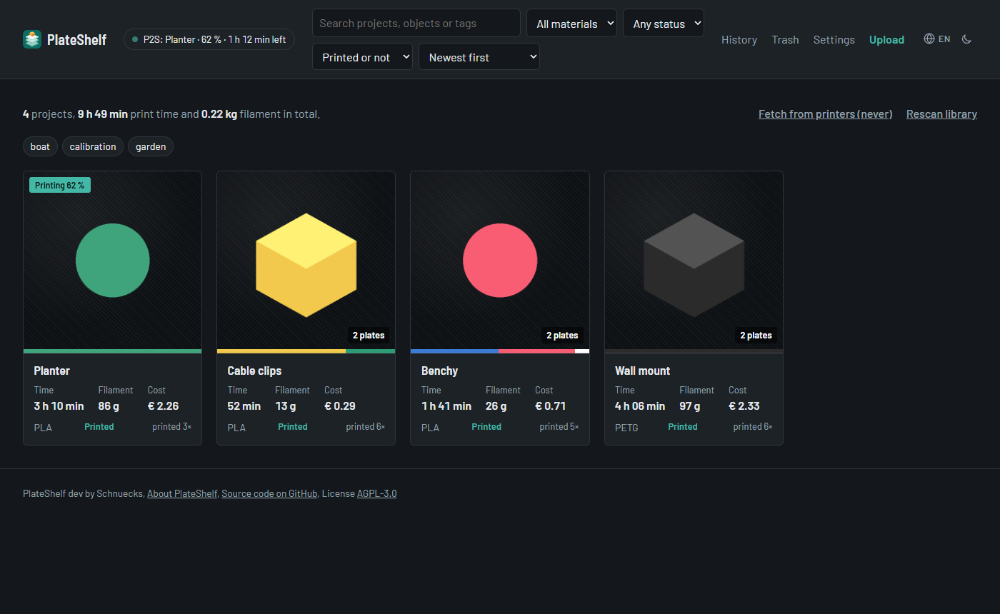
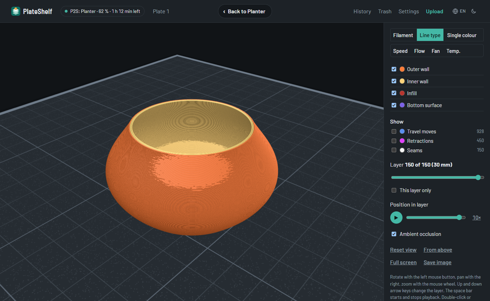
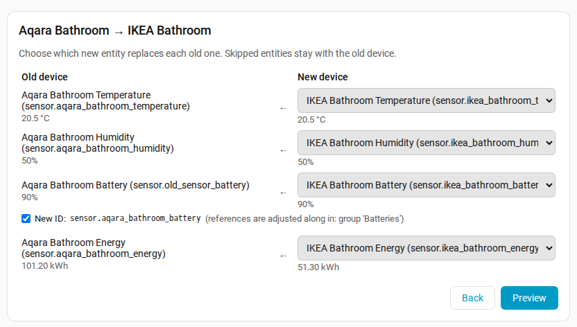
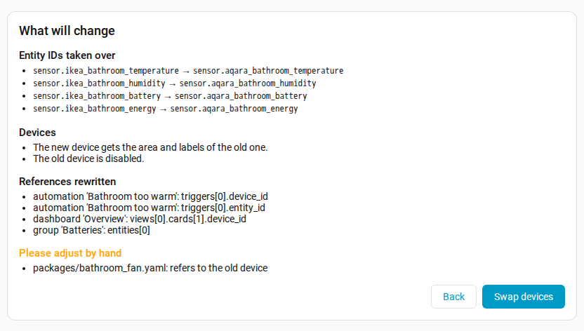
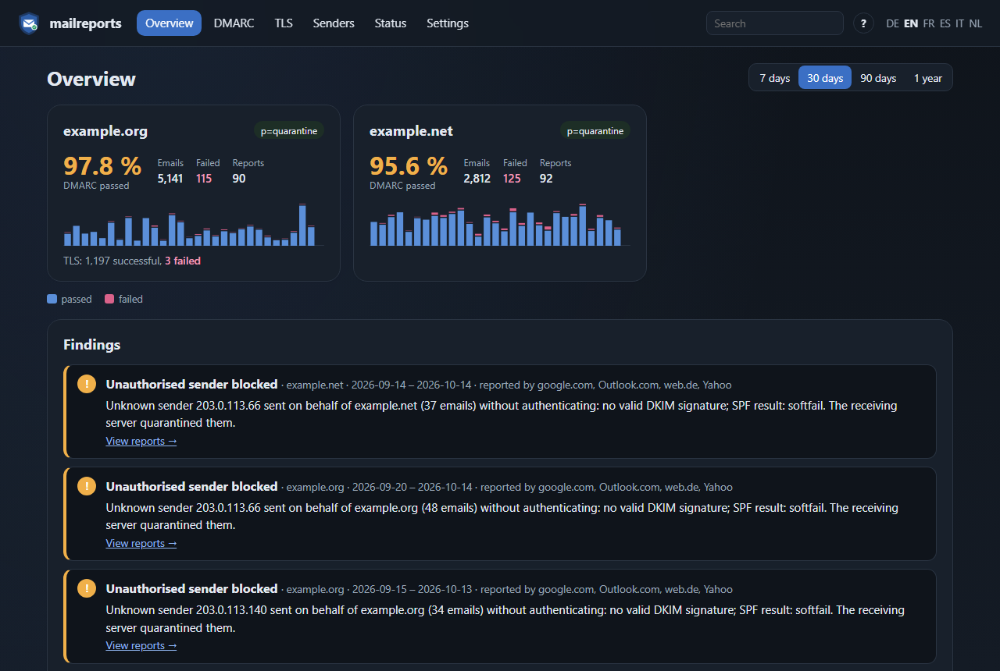
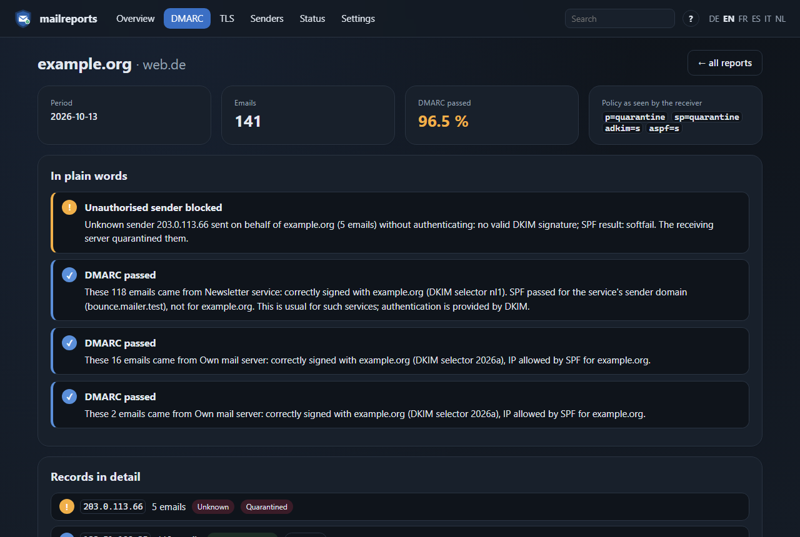
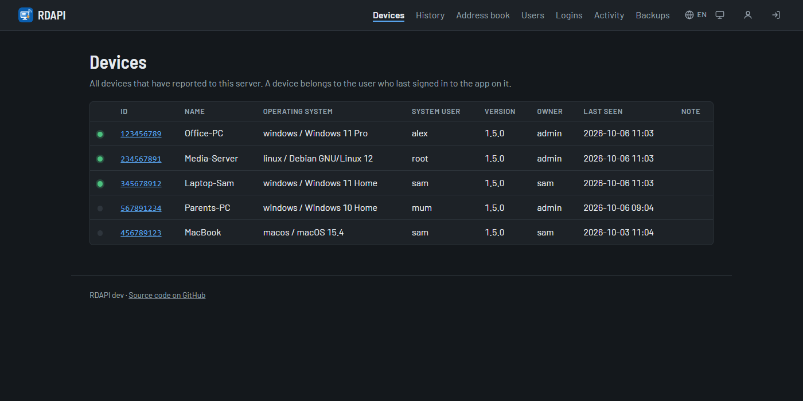
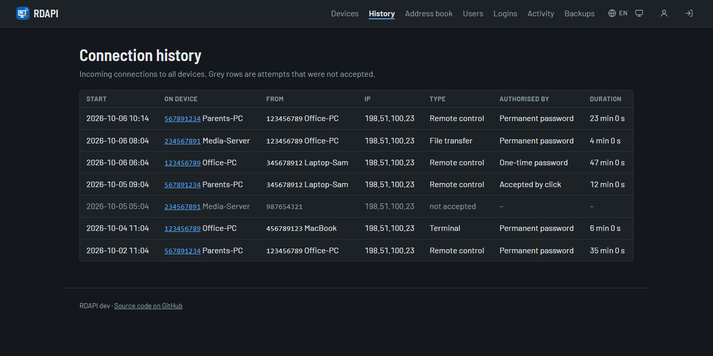
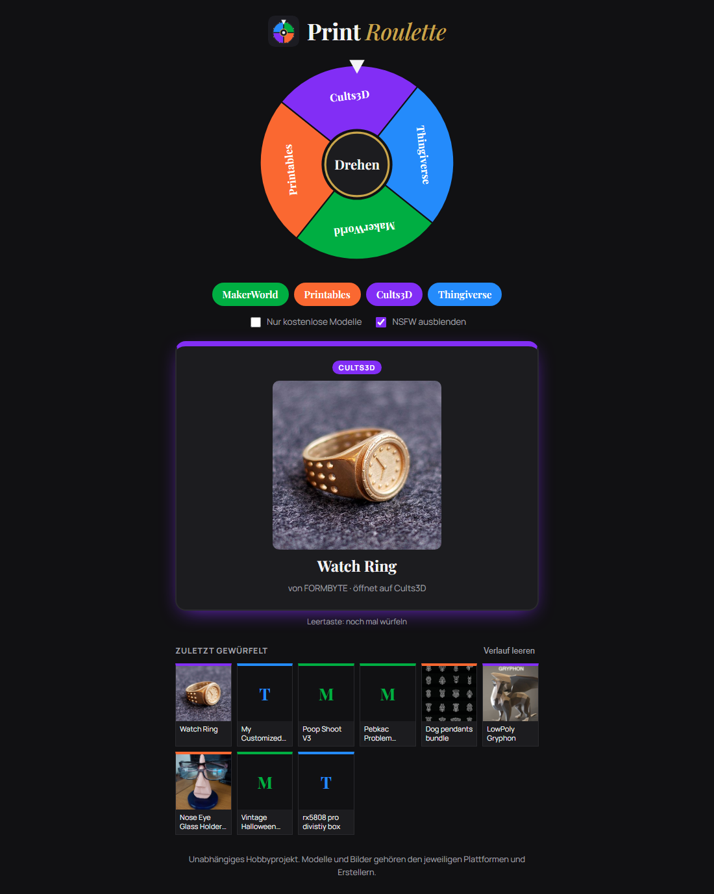

## Hi, I'm Schnuecks 👋

<b>🇩🇪 Auf Deutsch lesen</b>

 

**Hallo, ich bin Schnuecks!** 3D-Druck-Fan und Homelab-Bastler aus Deutschland. Ich baue kleine selbstgehostete Werkzeuge
für mein eigenes Setup und teile sie, wenn sie auch anderen helfen können.

- 🖨️ **3D-Druck** mit einem Bambu Lab P2S und einem Prusa Mini+
- 🏠 **Homelab & Self-Hosting**: eigene Dienste zuhause, in Docker
- 🐍 Meistens **Python**, **Rust** dazu etwas Shell
- 🌐 Alle Projekte auf einen Blick: **[schnuecks.dev/de](https://schnuecks.dev/de/)**

Ich entwickle mit einem KI-Assistenten an meiner Seite. Er schreibt einen guten Teil von Code,
Tests und Doku, aber was gebaut wird, wie es sich verhält und was am Ende veröffentlicht wird,
entscheide ich. Jedes Release läuft vorher eine Weile auf meiner eigenen Hardware.

Wichtiger als jede Funktion ist mir dabei die Sicherheit: Wenn sich etwas nicht sicher umsetzen
lässt, baue ich es lieber gar nicht. Deshalb durchläuft jedes Projekt bei jeder Änderung
seine Tests, einen Container-Scan (Trivy) und Dependabot; die Web-Apps werden zusätzlich mit
OWASP ZAP gescannt. Vor der Veröffentlichung bekommt jedes Projekt einen Sicherheits-Review:
Funde werden mit einem Test nachgestellt, behoben und danach erneut geprüft – nachzulesen in den
Changelogs. Etwas gefunden? Jedes Repository hat eine Sicherheitsrichtlinie, um es vertraulich
zu melden.

Wenn dir meine Projekte helfen, kannst du mir gern auf Ko-fi einen Kaffee ausgeben ☕

  

---

###  [PlateShelf](https://github.com/Schnuecks/plateshelf) 

**Ein selbstgehostetes Archiv für deine 3D-Drucke.** PlateShelf liest geslicte Dateien aus
Bambu Studio, OrcaSlicer, PrusaSlicer, Cura und anderen und zeigt sie so übersichtlich wie dein
Slicer: Platten mit Vorschau, Druckzeit, Filament, Kosten und eine 3D-Vorschau der echten
Druckbahnen.

- Direktimport von **Bambu-Lab-**, **Prusa-** (PrusaLink), **Klipper-** (Moonraker) und **OctoPrint-**Druckern
- **Druckverlauf** mit Statistik, Notizen je Druck und eigenen Fotos vom fertigen Druck
- Benutzerkonten mit Rollen, Passkeys, Single Sign-on, tägliche Sicherungen, sechs Sprachen, helles und dunkles Design
- Läuft als ein einziger Docker-Container auf PC, NAS oder Raspberry Pi

  
  

---

###  [Nine Lives](https://github.com/Schnuecks/ha-nine-lives) 

**Einem Gerät in Home Assistant ein neues Leben geben.** Nine Lives ersetzt ein Gerät, ohne etwas
kaputtzumachen: Das neue Gerät übernimmt Entity-IDs, Einstellungen und Verlauf des alten, und
Automationen, Dashboards und das Energie-Dashboard laufen einfach weiter – zum Beispiel beim
Umzug von Sensoren von Zigbee auf Thread/Matter.

- **Entitäten nach Typ und Einheit gepaart**, mit Vorschau jeder Änderung und Rückgängig mit einem Klick
- **Verlauf und Langzeitstatistik** laufen weiter, Zählerstände ohne Sprung im Energie-Dashboard
- **Verweise mitgezogen**: Geräte-Trigger, Dashboards, Gruppen und andere Helfer; YAML-Dateien werden nur gemeldet
- Tauscht sogar, wenn das alte Gerät schon in der App des Herstellers gelöscht wurde; Installation über HACS

  <a href="https://github.com/Schnuecks/ha-nine-lives"><picture><source media="(prefers-color-scheme: dark)" srcset="assets/nine-lives-pairs-dark.png"></picture></a>
  <a href="https://github.com/Schnuecks/ha-nine-lives"><picture><source media="(prefers-color-scheme: dark)" srcset="assets/nine-lives-preview-dark.png"></picture></a>

---

###  [mailreports](https://github.com/Schnuecks/mailreports) 

**DMARC- und TLS-Berichte im Klartext.** mailreports holt die täglichen DMARC- und
SMTP-TLS-Berichte deiner Domains aus einem Postfach und erklärt sie: wer in deinem Namen
E-Mails versendet hat, ob sie echt waren und wie die empfangenden Server damit verfahren sind –
statt XML und Fehlercodes.

- **Jeder Berichtseintrag erklärt**, Absender eingeordnet als eigene Server, beauftragte Dienste, Weiterleitungen oder Unbekannte, mit Reverse-DNS und Netz
- **DNS-Prüfung** für DMARC, SPF, DKIM, MTA-STS und TLS-RPT und eine Empfehlung, wann die Richtlinie strenger werden kann
- **Benachrichtigungen** per Pushover, ntfy, Webhook oder E-Mail, dazu eine Wochenübersicht
- Passkeys, Single Sign-on, sechs Sprachen; ein Container, eine SQLite-Datei. Mehr auf [schnuecks.dev](https://schnuecks.dev/de/mailreports/)

  
  

---

###  [RDAPI](https://github.com/Schnuecks/rdapi) 

**Ein schlanker, selbstgehosteter API-Server für die RustDesk-App.** RDAPI ergänzt deinen
eigenen ID- und Relay-Server um das, was ein Haushalt oder ein kleines Team braucht: Anmeldung
in der App, ein Adressbuch, das dir auf jedes Gerät folgt, eine Geräteliste und einen Verlauf
eingehender Verbindungen.

- **Adressbuch** pro Benutzer mit Tags, auf allen deinen Geräten gleich
- **Geräteliste** mit Online-Status und **Verbindungsverlauf**: wer sich wann und wie lange verbunden hat
- Zwei-Faktor-Anmeldung, **Passkeys** und **Single Sign-on** über OpenID Connect
- Weboberfläche in sechs Sprachen, tägliche Sicherungen, ein Container mit einer SQLite-Datei

Öffentliche Beta: Alles funktioniert, aber eine angemeldete App kann sich erst verbinden, wenn
RustDesk die Korrektur für seinen ID-Server veröffentlicht. Mehr auf [schnuecks.dev](https://schnuecks.dev/de/rdapi/).

  
  

---

###  [Print Roulette](https://github.com/Schnuecks/print-roulette) 

**Am Rad drehen und einen zufälligen 3D-Druck entdecken.** Print Roulette wählt ein Modell von
MakerWorld, Printables, Cults3D oder Thingiverse und verlinkt direkt auf dessen Seite – für die
Abende, an denen du etwas drucken willst, aber nicht weißt, was.

- **Glücksrad** in den Farben der Plattformen: für eine zufällige Plattform drehen oder direkt auf einer würfeln
- **Vorschaubild, Titel und Ersteller**, Filter für kostenlose Modelle und gegen NSFW-Inhalte
- **Keine Datenbank, keine Anmeldung, kein Tracking**, sechs Sprachen, helles und dunkles Design
- Ein kleiner Container ohne Abhängigkeiten außer der Python-Standardbibliothek

  
  

---

###  [traefik-pihole-sync](https://github.com/Schnuecks/traefik-pihole-sync) 

**Traefik-Hostnamen als lokale DNS-Einträge in Pi-hole v6.** Starte einen Container mit einer
`Host()`-Regel, und eine Minute später löst sein Name im ganzen Netz auf; entfernst du ihn,
verschwindet auch der Eintrag.

- **A-, AAAA- oder CNAME-Einträge**, für einen oder mehrere Pi-holes gleichzeitig
- **Sicher gebaut:** löscht nur Einträge, die es selbst angelegt hat, verzögertes Löschen, Probelauf-Modus
- Domainfilter, ruhige Logs und ein kleiner Container ohne Root-Rechte für amd64 und arm64

---

3D printing enthusiast and homelab tinkerer from Germany. I build small self-hosted tools
for my own setup and share them when they might be useful to others too.

- 🖨️ **3D printing** on a Bambu Lab P2S and a Prusa Mini+
- 🏠 **Homelab & self-hosting**: my own services at home, running in Docker
- 🐍 Mostly **Python**, with a bit of Shell
- 🌐 All my projects at a glance: **[schnuecks.dev](https://schnuecks.dev)**

I build my projects with an AI assistant by my side. It writes a good share of the code, tests
and docs, but what gets built, how it behaves and what finally gets released is my decision.
Every release runs on my own hardware for a while first.

Security matters more to me than any feature: if something can't be done securely, I'd rather
not build it at all. That's why every project runs its test suite, a container
scan (Trivy) and Dependabot on each change; the web apps are also scanned with OWASP ZAP.
Before going public, each project gets a security review: findings are reproduced with a test,
fixed, and the fix is checked again – you can follow it in the changelogs. Found something?
Every repository has a [security policy](https://github.com/Schnuecks/rdapi/security/policy)
for reporting it privately.

If my projects are useful to you, you can buy me a coffee ☕ on Ko-fi

  

---

###  [PlateShelf](https://github.com/Schnuecks/plateshelf) 

**A self-hosted archive for your 3D prints.** PlateShelf reads sliced files from Bambu Studio,
OrcaSlicer, PrusaSlicer, Cura and others and shows them as clearly as your slicer does:
plates with previews, print time, filament, costs and a 3D preview of the actual toolpaths.

- Direct import from **Bambu Lab**, **Prusa** (PrusaLink), **Klipper** (Moonraker) and **OctoPrint** printers
- **Print history** with statistics, notes per print and your own photos of the result
- User accounts with roles, passkeys, single sign-on, daily backups, six languages, light and dark theme
- Runs as a single Docker container on a PC, NAS or Raspberry Pi

  
  

---

###  [Nine Lives](https://github.com/Schnuecks/ha-nine-lives) 

**Give a device a new life in Home Assistant.** Nine Lives replaces a device without breaking
anything: the new device takes over the entity IDs, settings and history of the old one, so
automations, dashboards and the energy dashboard simply keep working – for example when moving
sensors from Zigbee to Thread/Matter.

- **Entities paired by type and unit**, with a preview of every change and one-click undo
- **History and long-term statistics** continue, meter sums without a jump in the energy dashboard
- **References taken along**: device triggers, dashboards, groups and other helpers; YAML files are only reported
- Swaps even when the old device was already deleted in the manufacturer's app; installed via HACS

  <a href="https://github.com/Schnuecks/ha-nine-lives"><picture><source media="(prefers-color-scheme: dark)" srcset="assets/nine-lives-pairs-dark.png"></picture></a>
  <a href="https://github.com/Schnuecks/ha-nine-lives"><picture><source media="(prefers-color-scheme: dark)" srcset="assets/nine-lives-preview-dark.png"></picture></a>

---

###  [mailreports](https://github.com/Schnuecks/mailreports) 

**DMARC and TLS reports in plain words.** mailreports fetches the daily DMARC and SMTP TLS
reports for your domains from a mailbox and explains them: who sent email in your name,
whether it was genuine and what the receiving servers did with it – instead of XML and
result codes.

- **Every report record explained**, senders classified as your own servers, services, forwarders or unknown, with reverse DNS and network
- **DNS check** for DMARC, SPF, DKIM, MTA-STS and TLS-RPT, and a recommendation when the policy can be tightened
- **Notifications** via Pushover, ntfy, webhook or email, plus a weekly summary
- Passkeys, single sign-on, six languages; one container, one SQLite file. More at [schnuecks.dev](https://schnuecks.dev/mailreports/)

  
  

---

###  [RDAPI](https://github.com/Schnuecks/rdapi) 

**A lean self-hosted API server for the RustDesk app.** RDAPI adds what a household or a
small team needs on top of your own ID and relay server: signing in to the app, an address
book that follows you to every device, a device list and a history of incoming connections.

- **Address book** per user with tags, synchronised between all your devices
- **Device list** with online status and a **connection history**: who connected when and for how long
- Two-factor sign-in, **passkeys** and **single sign-on** via OpenID Connect
- Web interface in six languages, daily backups, one container with one SQLite file

Public beta: everything works, but a signed-in app can only connect once RustDesk releases
its ID server fix. More at [schnuecks.dev](https://schnuecks.dev/rdapi/).

  
  

---

###  [Print Roulette](https://github.com/Schnuecks/print-roulette) 

**Spin the wheel and discover a random 3D print.** Print Roulette picks a model from
MakerWorld, Printables, Cults3D or Thingiverse and links straight to its page, for the
evenings when you want to print something but don't know what.

- **Prize wheel** in the platform colours: spin for a random platform or roll on one directly
- **Preview image, title and creator**, filters for free models and for hiding NSFW content
- **No database, no login, no tracking**, six languages, light and dark mode
- A small container with no dependencies beyond the Python standard library

  
  

---

###  [traefik-pihole-sync](https://github.com/Schnuecks/traefik-pihole-sync) 

**Traefik hostnames as local DNS records in Pi-hole v6.** Start a container with a `Host()`
rule and its name resolves on your network a minute later; remove it and the record goes
away again.

- **A, AAAA or CNAME records**, for one or several Pi-holes at once
- **Safe by design:** only deletes records it created itself, delayed deletion, dry-run mode
- Domain filter, quiet logs and a small non-root container for amd64 and arm64
